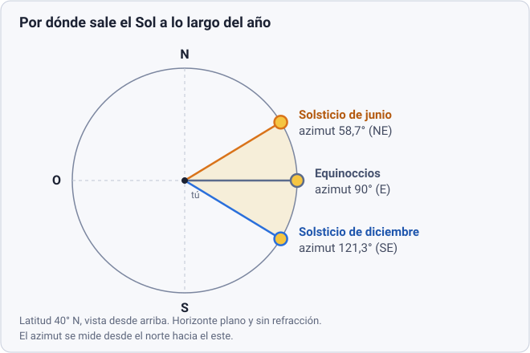

## La pregunta del cielo

Si miras el horizonte este durante unas semanas y marcas el punto por donde sale el Sol, verás que se desplaza. En diciembre sale bastante al sur del este; en junio, bastante al norte; solo alrededor de los equinoccios sale por el este. Con ese movimiento cambian también la altura del Sol al mediodía, la duración del día y, en último término, las estaciones.

Esta semana vas a explicarlo con un modelo cuantitativo y a comprobarlo con un planetario virtual. El modelo necesita muy pocas matemáticas, pero sí una buena costumbre: manejar con soltura números enormes y proporciones, que es el idioma de la astronomía. Por eso las dos primeras sesiones empiezan desde el principio: qué es una potencia de 10 y qué es una escala.

:::caution[Seguridad]
No mires nunca directamente al Sol, ni a simple vista ni con prismáticos o telescopio sin un filtro solar homologado. Todo lo que se pide esta semana se hace con un planetario en pantalla o con una marca en el horizonte, nunca apuntando un instrumento al Sol.
:::

:::note[De dónde viene la palabra]
**Astronomía** viene del griego *ástron*, «astro, estrella», y *nómos*, «ley, norma»: el estudio de las leyes de los astros. **Astrología** tiene la misma primera parte y *lógos*, «palabra, discurso». Durante siglos las dos palabras se usaron casi como sinónimos; la separación entre la ciencia y la adivinación se consolidó en los siglos XVII y XVIII.
:::

## Las cinco sesiones

### Sesión 1 · Matemáticas: potencias de 10 y notación científica (35-45 min)

**El problema.** En astronomía las magnitudes se salen de la escala humana: el radio del Sol mide 695 700 km y la longitud de onda de la luz verde, 0,000 000 5 m. Escribir tantos ceros es incómodo y es muy fácil equivocarse al contarlos. La solución es escribir los números con potencias de 10.

**Qué es una potencia de 10.** Una potencia es una multiplicación repetida. $10^3$ significa «multiplica 10 por sí mismo tres veces»: $10 \cdot 10 \cdot 10 = 1000$. El número pequeño de arriba, el **exponente**, dice cuántas veces se multiplica, y en las potencias de 10 coincide con el número de ceros que van detrás del 1:

| Potencia | Valor | Nombre |
|---|---|---|
| $10^0$ | 1 | uno |
| $10^1$ | 10 | diez |
| $10^2$ | 100 | cien |
| $10^3$ | 1000 | mil |
| $10^6$ | 1 000 000 | un millón |
| $10^9$ | 1 000 000 000 | mil millones |

**Por qué se suman los exponentes al multiplicar.** Mira qué pasa con $10^3 \cdot 10^2$: es $(10 \cdot 10 \cdot 10) \cdot (10 \cdot 10)$, cinco dieces multiplicados, es decir, $10^5$. Al multiplicar potencias de 10 se juntan los factores, y por eso los exponentes se suman: $10^m \cdot 10^n = 10^{m+n}$. Al dividir, los factores repetidos arriba y abajo se cancelan: $10^5 / 10^2 = 10^3$. Los exponentes se restan.

**Exponentes cero y negativos.** La regla de la división explica qué significan. $10^3 / 10^3 = 1$, pero restando exponentes sale $10^0$: por eso $10^0 = 1$. Y $10^2 / 10^5 = 1/1000$, mientras que restando sale $10^{-3}$: por eso un exponente negativo significa «uno dividido por»:

$$10^{-1} = \frac{1}{10} = 0{,}1, \qquad 10^{-3} = \frac{1}{1000} = 0{,}001, \qquad 10^{-6} = 0{,}000\,001.$$

Fíjate en que en $10^{-3}$ el 1 está en la tercera posición después de la coma.

**La notación científica.** Un número en notación científica se escribe como $a \times 10^n$, donde $a$, el **coeficiente**, está entre 1 y 10 (puede valer 1, pero no 10) y $n$ es un número entero. Para pasar un número a esta forma, se mueve la coma hasta que quede una sola cifra distinta de cero a su izquierda, y se cuenta cuántas posiciones se ha movido:

- 149 600 000 → la coma se mueve 8 posiciones a la izquierda → $1{,}496 \times 10^8$.
- 0,000 000 5 → la coma se mueve 7 posiciones a la derecha → $5 \times 10^{-7}$.

Mover la coma a la izquierda hace el coeficiente más pequeño, y el exponente positivo lo compensa; moverla a la derecha lo hace más grande, y el exponente negativo lo compensa. Pedir que el coeficiente esté entre 1 y 10 tiene una ventaja: cada número tiene una sola forma de escribirse, y el exponente te dice de un vistazo su tamaño, su **orden de magnitud**.

**Operar.** Para multiplicar, se multiplican los coeficientes y se suman los exponentes; para dividir, se dividen los coeficientes y se restan los exponentes. Si el coeficiente resultante no queda entre 1 y 10, se corrige: $20 \times 10^3 = 2 \times 10^4$.

**Los prefijos.** Las unidades del Sistema Internacional usan prefijos que son potencias de 10: **kilo** ($10^3$), **mega** ($10^6$), **giga** ($10^9$), **mili** ($10^{-3}$), **micro** ($10^{-6}$) y **nano** ($10^{-9}$). Un kilómetro son $10^3$ metros; un nanómetro, $10^{-9}$ metros. La luz verde tiene una longitud de onda de unos 500 nanómetros.

:::note[De dónde viene la palabra]
Los prefijos son griegos o latinos. **Kilo** viene del griego *khílioi*, «mil», y **mili**, del latín *mille*, también «mil» (pero dividiendo). **Mega** es el griego *mégas*, «grande»; **giga**, *gígas*, «gigante»; **micro**, *mikrós*, «pequeño»; y **nano**, *nânos*, «enano». **Metro** viene de *métron*, «medida». Kilo y mili nacieron en Francia en 1795, con el sistema métrico decimal, que buscaba unidades iguales en todas partes y que se pasara de unas a otras moviendo la coma. Mega, giga, micro y nano se añadieron después, y la lista quedó fijada con el Sistema Internacional en 1960.
:::

**Qué hacer**

1. Lee el apéndice de notación científica del libro *Astronomía* de OpenStax (recurso 1).
2. Resuelve los ejercicios de abajo sin calculadora hasta el último, donde sí puedes usarla.

**Datos que usarás esta semana**

| Magnitud | Valor |
|---|---|
| 1 unidad astronómica (UA), distancia media Tierra-Sol | 1,496 × 10⁸ km |
| Radio medio de la Tierra | 6371 km |
| Radio del Sol (valor nominal IAU) | 6,957 × 10⁵ km |
| Distancia media Tierra-Luna | 3,844 × 10⁵ km |
| Diámetro de la Luna | 3474 km |

La UA y el radio terrestre proceden de la ficha de la Tierra de la NASA (recurso 5), y el radio solar es el valor nominal que fijó la Unión Astronómica Internacional en 2015. Los de la Luna coinciden con los que publica la NASA (3474 km de diámetro y 384 400 km de distancia media). Son valores redondeados, suficientes para esta semana. La **unidad astronómica** es una unidad de longitud pensada para el Sistema Solar: medir la distancia a Júpiter en kilómetros es como medir la distancia entre dos ciudades en milímetros.

**Ejercicios**

1. Escribe en notación científica: 149 600 000 km y 0,000 000 5 m.
2. Expresa 1 UA en metros.
3. ¿Cuántas veces es mayor el radio del Sol que el de la Tierra?
4. ¿Cuántos diámetros terrestres caben entre la Tierra y la Luna?
5. Calcula (4 × 10⁶) · (5 × 10⁻³).
6. ¿Cuántas veces más lejos está el Sol que la Luna? ¿Y cuántas veces es mayor el diámetro del Sol que el de la Luna? Compara ambos resultados (usa calculadora).

Soluciones

1. 1,496 × 10⁸ km y 5 × 10⁻⁷ m.
2. 1,496 × 10⁸ km · 10³ m/km = 1,496 × 10¹¹ m. Los kilómetros se van: multiplicar por «metros por kilómetro» deja metros.
3. (6,957 × 10⁵) / (6,371 × 10³) = 1,092 × 10² ≈ 109.
4. Un diámetro terrestre es 2 · 6371 = 1,2742 × 10⁴ km. Entonces 3,844 × 10⁵ / 1,2742 × 10⁴ ≈ 30,2.
5. 4 · 5 = 20 y 6 + (−3) = 3: 20 × 10³ = 2 × 10⁴. Recuerda dejar el coeficiente entre 1 y 10.
6. El Sol está unas 389 veces más lejos (1,496 × 10⁸ / 3,844 × 10⁵), y su diámetro es unas 400 veces el de la Luna (1,3914 × 10⁶ / 3474). Las dos cifras casi coinciden, por eso el Sol y la Luna se ven con un tamaño aparente parecido en el cielo. Lo retomaremos en la semana 2.

### Sesión 2 · Matemáticas: proporciones y escalas (30-40 min)

**Razón y proporción.** Una **razón** es un cociente entre dos cantidades: si el Sol mide 109 radios terrestres, la razón entre los dos radios es 109. Una **proporción** es una igualdad entre dos razones: «la maqueta es al tamaño real lo que 1 es a 10 millones». La herramienta de la escuela para resolverlas es la **regla de tres**: si 10 cm de maqueta representan 1,3914 × 10⁶ km reales, ¿cuántos centímetros representan 12 742 km? La respuesta es $10 \cdot 12\,742 / 1{,}3914 \times 10^6$.

**Escala.** Una escala es una proporción fija: todo lo real se multiplica por el mismo número, el **factor de escala**. En lugar de hacer una regla de tres para cada objeto, se calcula ese factor una vez y se usa para todo. Si decides que el Sol de tu maqueta mide 10 cm, el factor de escala es 10 cm dividido por el diámetro real del Sol, y con ese único número sale el tamaño y la distancia de todo lo demás.

Un consejo que te ahorrará errores toda la fase: **escribe siempre las unidades** y trátalas como si fueran números. Un factor en «cm por km» multiplicado por una longitud en km da cm: los kilómetros se cancelan, igual que se cancelan los números repetidos arriba y abajo de una fracción. Si al final las unidades no son las que esperabas, hay un error.

**Ejemplo resuelto.** Diámetro real del Sol: 2 · 6,957 × 10⁵ = 1,3914 × 10⁶ km. Factor: 10 cm / 1,3914 × 10⁶ km ≈ 7,19 × 10⁻⁶ cm por km. Entonces:

- Diámetro de la Tierra: 12 742 km · 7,19 × 10⁻⁶ cm/km ≈ 0,092 cm, es decir, **0,92 mm**.
- Distancia Tierra-Sol: 1,496 × 10⁸ km · 7,19 × 10⁻⁶ cm/km ≈ 1075 cm, es decir, **unos 10,8 m**.
- Distancia a la Luna: 3,844 × 10⁵ km · 7,19 × 10⁻⁶ cm/km ≈ **2,8 cm**.

El resultado es contraintuitivo: con un Sol del tamaño de una pelota de 10 cm, la Tierra es una cuenta de menos de 1 mm situada a casi 11 metros. Los dibujos de los libros, que representan los planetas grandes y próximos, no están a escala: si lo estuvieran, no se vería nada.

:::note[De dónde viene la palabra]
**Escala** viene del latín *scala*, «escalera». Una escala es una serie de marcas ordenadas, como peldaños, y de ahí pasó a significar la regla graduada que se dibuja en los mapas y, después, la proporción entre el mapa y la realidad. **Razón** viene del latín *ratio*, «cálculo, cuenta»: en matemáticas sigue significando un cociente, y de la misma palabra vienen *ración* y *racional*.
:::

**Ejercicios**

1. Tu Sol es un balón de 22 cm de diámetro. ¿Qué tamaño tiene la Tierra, a qué distancia del Sol está y a qué distancia de la Tierra está la Luna?
2. Ahora la Tierra es una canica de 1,2 cm. ¿Qué diámetro tiene el Sol y a qué distancia está? ¿A qué distancia está la Luna?
3. ¿Por qué las dos maquetas dan las mismas proporciones entre sí aunque los tamaños sean distintos?

Soluciones

1. Tierra: 22 cm / 109,2 ≈ 0,20 cm = **2,0 mm**. Distancia al Sol: 1,496 × 10⁸ / 1,3914 × 10⁶ ≈ 107,5 diámetros solares, y 107,5 · 22 cm ≈ **23,7 m**. La Luna está a 30,2 diámetros terrestres: 30,2 · 2,0 mm ≈ **6,1 cm**.
2. Sol: 109,2 · 1,2 cm ≈ **131 cm**. Distancia al Sol: 1,496 × 10⁸ / 1,2742 × 10⁴ ≈ 11 740 diámetros terrestres, y 11 740 · 1,2 cm ≈ **141 m**. Luna: 30,2 · 1,2 cm ≈ **36 cm**.
3. Porque la escala solo cambia el factor global. Las razones entre magnitudes (Sol/Tierra ≈ 109, Sol-Tierra / diámetro solar ≈ 107,5, etc.) son una propiedad del sistema y no dependen de la unidad ni del tamaño de la maqueta.

### Sesión 3 · Física: rotación, traslación e inclinación (35-45 min)

Tres hechos describen casi todo lo que ocurre esta semana. Pásalos a un papel con tus palabras después de leer.

1. **Rotación.** La Tierra gira sobre un eje imaginario que pasa por los polos norte y sur. Da una vuelta cada 23 h 56 min respecto a las estrellas: es el **día sidéreo** (de *sidus*, «estrella» en latín), que según la NASA dura 23,9345 h. El **día solar** medio, de un mediodía al siguiente, dura 24 h. La diferencia viene de que, mientras gira, la Tierra avanza también en su órbita alrededor del Sol, unos 0,986° al día (360° / 365,25), y tiene que girar ese poco más para que el Sol vuelva a quedar en la misma dirección. Como la Tierra gira 360° en 24 h, es decir, 1° cada 4 minutos, esa diferencia es de unos 4 minutos.
2. **Traslación.** La Tierra completa una vuelta alrededor del Sol en unos 365,25 días. El cuarto de día que sobra es la razón de que haya años bisiestos: cada cuatro años se acumula casi un día entero.
3. **Inclinación.** El eje de rotación no es perpendicular al plano de la órbita: forma con la perpendicular un ángulo de 23,44°. Además, mientras la Tierra da la vuelta al Sol, el eje apunta siempre hacia la misma dirección del espacio (hacia la estrella Polar, más o menos), como una peonza inclinada que se desplazara sin girar su eje. Por eso, en una parte de la órbita el hemisferio norte está inclinado hacia el Sol y en la parte opuesta lo está el sur.

**Del espacio al cielo.** Imagina el ecuador de la Tierra proyectado hacia fuera, sobre el cielo: es el **ecuador celeste**, una línea que divide el cielo en una mitad norte y una mitad sur. El ángulo de un astro al norte o al sur de esa línea se llama **declinación**, y es al cielo lo que la latitud es a la Tierra (lo estudiarás a fondo en la semana 3).

Cuando el hemisferio norte está inclinado hacia el Sol, en junio, desde la Tierra vemos el Sol 23,44° al norte del ecuador celeste: su declinación es +23,44°. En diciembre ocurre al revés: −23,44°. Entre medias, en los dos **equinoccios** de marzo y septiembre, el eje no está inclinado ni hacia el Sol ni en contra, y el Sol está justo sobre el ecuador celeste: declinación 0°. A lo largo del año, la declinación del Sol sube y baja como una onda entre esos dos extremos.

**Por qué cambia el punto de salida.** Durante un día, la rotación de la Tierra arrastra al Sol por el cielo a lo largo de un círculo paralelo al ecuador celeste. El ecuador celeste corta el horizonte exactamente por el este y por el oeste, en cualquier lugar de la Tierra salvo en los polos. Si el círculo diario del Sol está desplazado hacia el norte, corta el horizonte al norte del este; si está desplazado al sur, al sur del este. El punto del horizonte por donde sale el Sol depende de su declinación: de ahí su desplazamiento a lo largo del año.

*Diagrama de elaboración propia, calculado con el modelo del cuaderno de esta semana. Entre el solsticio de junio y el de diciembre el punto de salida recorre unos 63° del horizonte (de 58,7° a 121,3°).*

**Por qué hace más calor en verano.** El mismo desplazamiento tiene dos consecuencias. La primera: en el hemisferio norte, cuando el círculo diario del Sol está desplazado al norte, una parte mayor de ese círculo queda por encima del horizonte, y los días son más largos. La segunda: el Sol sube más alto. Al mediodía, su altura sobre el horizonte sur es

$$\text{altura al mediodía} = 90^\circ - \text{latitud} + \text{declinación}.$$

A 40° de latitud norte, eso da 73,4° en el solsticio de junio y 26,6° en el de diciembre. Un Sol alto calienta más porque su luz cae más concentrada. Piensa en una linterna: apuntada en perpendicular a una pared ilumina un círculo pequeño y brillante; inclinada, la misma luz se reparte en una mancha alargada y más tenue. Con el Sol a 73° la misma superficie del suelo recibe más del doble de energía que con el Sol a 27°. Días más largos y luz más concentrada: eso es el verano.

**¿Y la distancia al Sol?** Es la explicación intuitiva y es falsa. La Tierra está más cerca del Sol (perihelio, 147,1 millones de km) a principios de enero, y más lejos (afelio, 152,1 millones de km) a principios de julio. Si la distancia fuera la causa de las estaciones, el hemisferio norte tendría su verano en enero. Además, ambos hemisferios tienen estaciones opuestas al mismo tiempo, algo imposible si la causa fuera común. La diferencia de distancia es del 3,4 %. La energía que llega del Sol se reparte sobre una esfera cada vez más grande a medida que se aleja, y la superficie de una esfera crece con el cuadrado del radio (lo verás en la semana 16): por eso la energía recibida cambia como $1/d^2$, y entre los dos extremos varía en torno a un 7 %. Es un efecto real, pero pequeño frente al de la inclinación.

*Imagen: NASA Space Place (JPL-Caltech), en inglés. La órbita está exagerada: en realidad es casi circular. La página de origen no indica un crédito individual para esta imagen, y remite a las directrices de uso de medios de la NASA y a la política de imágenes del JPL.*

:::note[De dónde viene la palabra]
**Equinoccio** viene del latín *aequinoctium*, de *aequus*, «igual», y *nox, noctis*, «noche»: el día en que la noche dura lo mismo que el día. **Solsticio** viene de *solstitium*, de *sol* y *sistere*, «detenerse»: en los solsticios el Sol deja de desplazarse hacia el norte (o hacia el sur), parece quedarse quieto unos días y da la vuelta. **Declinación** viene de *declinare*, «apartarse, desviarse»: lo que el astro se aparta del ecuador. **Eje** viene del latín *axis*, el eje de un carro.
:::

**Qué hacer**

1. Lee la explicación de NASA Space Place (recurso 2, hay versión en español). Es de nivel divulgativo, pensada para un público joven: úsala para fijar la idea, no como fuente de rigor.
2. Contrasta las cifras de órbita y rotación de arriba con la ficha de la Tierra de la NASA (recurso 5).
3. Calcula con la fórmula de arriba la altura del Sol al mediodía en los solsticios y los equinoccios en tu latitud.
4. Responde por escrito: ¿qué ocurriría con las estaciones si el eje no estuviera inclinado? ¿Y si lo estuviera 45°?

### Sesión 4 · Astronomía y observación (30-45 min)

Aquí conviertes la pregunta en una medida. Necesitas Stellarium, en su versión web o en la de escritorio (recursos 3 y 4). Los menús cambian de nombre entre versiones, así que busca el ajuste de **ubicación** y el de **fecha y hora**.

**Dos ángulos para decir dónde está algo en el cielo.** Para señalar un punto del cielo desde donde estás bastan dos ángulos. La **altura** es el ángulo sobre el horizonte: 0° en el horizonte y 90° justo encima de tu cabeza, en el **cénit**. El **azimut** es la dirección a lo largo del horizonte, medida desde el norte hacia el este: norte 0°, este 90°, sur 180°, oeste 270°. Un Sol que sale con azimut 60° sale 30° al norte del este. En la semana 3 verás estos ángulos con más detalle.

:::note[De dónde viene la palabra]
**Azimut** y **cénit** vienen del árabe, la lengua de la astronomía medieval. *As-samt* significa «el camino, la dirección», y su plural *as-sumūt*, «las direcciones», dio *azimut*. **Cénit** viene de *samt ar-ra's*, «la dirección de la cabeza»; los copistas medievales leyeron mal la palabra en los manuscritos (confundieron la *m* con *ni*) y de *samt* salió *cenit*. **Horizonte** es griego: *horízōn kýklos*, «el círculo que delimita», de *horízein*, «limitar, marcar una frontera».
:::

**Medidas en Stellarium**

1. Fija una ubicación. Usa la de tu ciudad o cualquier otra de latitud conocida: esta semana te interesa la **latitud**. Anótala.
2. Pon la fecha de cada una de estas cuatro fechas (varían un día o dos según el año): equinoccio de primavera (en torno al 20-21 de marzo), solsticio de junio (en torno al 21 de junio), equinoccio de otoño (en torno al 22-23 de septiembre) y solsticio de diciembre (en torno al 21 de diciembre).
3. En cada una, avanza el tiempo hasta el instante en que el Sol cruza el horizonte al salir. Selecciona el Sol: el panel de información muestra su **azimut** y su altura.
4. Anota en una tabla la fecha, la hora de salida y el azimut.
5. Avanza hasta el mediodía (el momento en que el Sol está más alto) y anota su altura. Compárala con la que calculaste en la sesión 3.

**Atención a la convención del azimut.** En astronomía se mide desde el norte hacia el este (norte = 0°, este = 90°). Algunas versiones de Stellarium lo muestran medido desde el sur. Si al salir el Sol por el este te sale en torno a 270° o a −90°, es esa convención. Para convertir al azimut medido desde el norte, suma 180° y resta 360° si te pasas de 360°.

**Observación real (opcional, sin instrumentos).** Elige un lugar con vista del horizonte este o oeste y un punto de referencia fijo (un edificio, un árbol, una cumbre). Anota dónde sale o se pone el Sol respecto a esa referencia, y repítelo cada dos semanas. En el hemisferio norte, entre el equinoccio de septiembre y el solsticio de diciembre, el punto de salida se desplaza hacia el sur semana a semana. Mira el horizonte, nunca el disco del Sol.

### Sesión 5 · Proyecto en Python (30-45 min)

Trabajarás en un cuaderno de Python que se abre en el navegador con Google Colab (recurso 6), sin instalar nada. Un **cuaderno** es un documento que mezcla texto y trozos de código que puedes ejecutar uno a uno, cambiar y volver a ejecutar. El cuaderno de la semana 1:

- te enseña a usar Python como calculadora científica con notación científica,
- construye la maqueta a escala de la sesión 2,
- implementa un modelo de horas de luz y de azimut de salida del Sol según la latitud y el día del año,
- compara el modelo con las medidas que tomaste en Stellarium.

[Abrir el cuaderno en Colab](https://colab.research.google.com/github/alabcar/hola-universo/blob/main/cuadernos/fase-1/semana-01.ipynb) · [Ver el cuaderno en GitHub](https://github.com/alabcar/hola-universo/blob/main/cuadernos/fase-1/semana-01.ipynb)

El modelo del cuaderno usa fórmulas de trigonometría que todavía no has estudiado. De momento las tratas como una caja negra y compruebas que funcionan comparándolas con Stellarium. En la semana 7 aprenderás el seno y el coseno, y en la fase 2 entenderás de dónde salen.

## Qué has aprendido

- **La respuesta.** El Sol sale exactamente por el este solo en los equinoccios. Entre marzo y septiembre sale al norte del este (en el hemisferio norte) y el resto del año, al sur. La desviación máxima, en los solsticios, depende de la latitud: en torno a 31° a 40° de latitud norte, y 23,4° en el ecuador.
- **La causa.** El eje de la Tierra está inclinado 23,44° y apunta siempre a la misma dirección mientras la Tierra completa su órbita en unos 365,25 días. La declinación del Sol oscila así entre +23,44° y −23,44° a lo largo del año, y su círculo diario por el cielo se desplaza al norte y al sur del ecuador celeste.
- **Las estaciones.** En verano el Sol pasa más horas sobre el horizonte y sube más alto, y su luz llega más concentrada. La distancia al Sol apenas influye: estamos más cerca en enero.
- **Las herramientas.** Potencias de 10 y notación científica para trabajar con cifras astronómicas, el factor de escala para pensar en proporciones, la costumbre de arrastrar las unidades en los cálculos y la de contrastar un modelo con una medida independiente.

## Recursos

Los recursos marcados con **(sin verificar)** son enlaces que no he podido abrir desde mi entorno. Comprueba que funcionan antes de fiarte.

1. [Apéndice C: notación científica, *Astronomía* (OpenStax), en LibreTexts Español](https://espanol.libretexts.org/Fisica/Astronomia_y_Cosmologia/Libro%3A_Astronom%C3%ADa_%28OpenStax%29/31%3A_Ap%C3%A9ndices/31.03%3A_Notaci%C3%B3n_cient%C3%ADfica_%28Ap%C3%A9ndice_C%29). Español, texto con ejercicios resueltos, unos 30 min. Licencia CC BY 4.0. Verificado el 31 de octubre de 2026.
2. [¿Qué causa las estaciones? NASA Space Place](https://spaceplace.nasa.gov/seasons/en) (versión en español: [Space Place](https://spaceplace.nasa.gov/seasons/sp/)). Inglés y español, divulgación para público joven, 5-10 min. Verificado el 31 de octubre de 2026.
3. [Stellarium Web](https://stellarium-web.org/). Planetario en el navegador, gratuito; es la forma más rápida de empezar. **(Sin verificar)**: el enlace figura en varias fuentes secundarias, pero no he podido abrirlo.
4. [Stellarium (versión de escritorio)](https://stellarium.org/). Programa gratuito y de código abierto para Windows, macOS y Linux; más potente que la versión web. **(Sin verificar)**: no he podido abrirlo desde mi entorno.
5. [Ficha de la Tierra, NASA NSSDCA](https://nssdc.gsfc.nasa.gov/planetary/factsheet/earthfact.html). Inglés, tabla de datos de referencia (radio, órbita, rotación, oblicuidad). **(Sin verificar)** directamente: no he podido abrir la página, pero los valores que cito coinciden con su contenido tal como lo he visto reproducido en una búsqueda.
6. [Google Colab](https://colab.research.google.com/). Entorno gratuito para ejecutar Python en el navegador; necesita una cuenta de Google. **(Sin verificar)**: no he podido abrirlo desde mi entorno.

## Imágenes y créditos

- Diagrama de la salida del Sol (sesión 3): elaboración propia, a partir del modelo del cuaderno.
- Órbita de la Tierra con perihelio y afelio (sesión 3): NASA Space Place (JPL-Caltech), [spaceplace.nasa.gov/seasons](https://spaceplace.nasa.gov/seasons/en). Se carga desde el servidor de la NASA; se ha comprobado que se ve correctamente en la web publicada.
