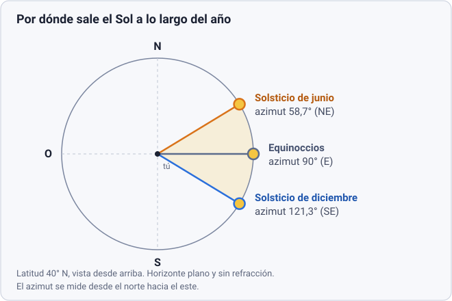

## La pregunta del cielo

Si miras el horizonte este durante unas semanas y marcas el punto por donde sale el Sol, verás que se desplaza. En diciembre sale bastante al sur del este; en junio, bastante al norte; solo alrededor de los equinoccios sale por el este. Con ese movimiento cambian también la altura del Sol al mediodía, la longitud del día y, en último término, las estaciones.

Esta semana vas a explicarlo con un modelo cuantitativo y a comprobarlo con un planetario virtual. El modelo necesita muy poca matemática, pero sí una buena costumbre: manejar con soltura números enormes y proporciones, que es el idioma de la astronomía.

:::caution[Seguridad]
No mires nunca directamente al Sol, ni a simple vista ni con prismáticos o telescopio sin un filtro solar homologado. Todo lo que se pide esta semana se hace con un planetario en pantalla o con una marca en el horizonte, nunca apuntando un instrumento al Sol.
:::

## Las cinco sesiones

### Sesión 1 · Matemáticas: potencias de 10 y notación científica (30-40 min)

En astronomía las magnitudes se salen de la escala humana: un radio solar son 695 700 km y la longitud de onda de la luz verde, 0,000 000 5 m. Escribir tantos ceros es incómodo y propenso a errores. La **notación científica** expresa un número como *a* × 10ⁿ con 1 ≤ *a* < 10 y *n* entero, y convierte multiplicar y dividir en operaciones con exponentes: se multiplican los coeficientes y se suman los exponentes (o se dividen y se restan).

**Qué hacer**

1. Lee el apéndice de notación científica del libro *Astronomía* de OpenStax (recurso 1).
2. Resuelve los ejercicios de abajo sin calculadora hasta el último, donde sí puedes usarla.

**Datos que usarás esta semana**

| Magnitud | Valor |
|---|---|
| 1 unidad astronómica (UA), distancia media Tierra-Sol | 1,496 × 10⁸ km |
| Radio medio de la Tierra | 6371 km |
| Radio del Sol (valor nominal IAU) | 6,957 × 10⁵ km |
| Distancia media Tierra-Luna | 3,844 × 10⁵ km |
| Diámetro de la Luna | 3474 km |

La UA y el radio terrestre proceden de la ficha de la Tierra de la NASA (recurso 5), y el radio solar es el valor nominal que fijó la Unión Astronómica Internacional en 2015. Los de la Luna coinciden con los que publica la NASA (3474 km de diámetro y 384 400 km de distancia media). Son valores redondeados, suficientes para esta semana.

**Ejercicios**

1. Escribe en notación científica: 149 600 000 km y 0,000 000 5 m.
2. Expresa 1 UA en metros.
3. ¿Cuántas veces es mayor el radio del Sol que el de la Tierra?
4. ¿Cuántos diámetros terrestres caben entre la Tierra y la Luna?
5. Calcula (4 × 10⁶) · (5 × 10⁻³).
6. ¿Cuántas veces más lejos está el Sol que la Luna? ¿Y cuántas veces es mayor el diámetro del Sol que el de la Luna? Compara ambos resultados (usa calculadora).

Soluciones

1. 1,496 × 10⁸ km y 5 × 10⁻⁷ m.
2. 1,496 × 10⁸ km · 10³ m/km = 1,496 × 10¹¹ m.
3. (6,957 × 10⁵) / (6,371 × 10³) = 1,092 × 10² ≈ 109.
4. Un diámetro terrestre es 2 · 6371 = 1,2742 × 10⁴ km. Entonces 3,844 × 10⁵ / 1,2742 × 10⁴ ≈ 30,2.
5. 20 × 10³ = 2 × 10⁴. Recuerda dejar el coeficiente entre 1 y 10.
6. El Sol está unas 389 veces más lejos (1,496 × 10⁸ / 3,844 × 10⁵), y su diámetro es unas 400 veces el de la Luna (1,3914 × 10⁶ / 3474). Las dos cifras casi coinciden, por eso el Sol y la Luna se ven con un tamaño aparente parecido en el cielo. Lo retomaremos en la semana 2.

### Sesión 2 · Matemáticas: proporciones y escalas (30-40 min)

Una escala es una proporción fija: todo lo real se multiplica por el mismo factor. Si decides que el Sol de tu maqueta mide 10 cm, el factor de escala es 10 cm dividido por el diámetro real del Sol, y con ese único número sale el tamaño y la distancia de todo lo demás. Es una regla de tres con una sola constante.

**Ejemplo resuelto.** Diámetro real del Sol: 2 · 6,957 × 10⁵ = 1,3914 × 10⁶ km. Factor: 10 cm / 1,3914 × 10⁶ km ≈ 7,19 × 10⁻⁶ cm por km. Entonces:

- Diámetro de la Tierra: 12 742 km · 7,19 × 10⁻⁶ cm/km ≈ 0,092 cm, es decir, **0,92 mm**.
- Distancia Tierra-Sol: 1,496 × 10⁸ km · 7,19 × 10⁻⁶ cm/km ≈ 1075 cm, es decir, **unos 10,8 m**.
- Distancia a la Luna: 3,844 × 10⁵ km · 7,19 × 10⁻⁶ cm/km ≈ **2,8 cm**.

El resultado es contraintuitivo: con un Sol del tamaño de una pelota de 10 cm, la Tierra es una cuenta de menos de 1 mm situada a casi 11 metros. Los dibujos de los libros, que representan los planetas grandes y próximos, no están a escala.

**Ejercicios**

1. Tu Sol es un balón de 22 cm de diámetro. ¿Qué tamaño tiene la Tierra, a qué distancia del Sol está y a qué distancia de la Tierra está la Luna?
2. Ahora la Tierra es una canica de 1,2 cm. ¿Qué diámetro tiene el Sol y a qué distancia está? ¿A qué distancia está la Luna?
3. ¿Por qué las dos maquetas dan las mismas proporciones entre sí aunque los tamaños sean distintos?

Soluciones

1. Tierra: 22 cm / 109,2 ≈ 0,20 cm = **2,0 mm**. Distancia al Sol: 1,496 × 10⁸ / 1,3914 × 10⁶ ≈ 107,5 diámetros solares, y 107,5 · 22 cm ≈ **23,7 m**. La Luna está a 30,2 diámetros terrestres: 30,2 · 2,0 mm ≈ **6,1 cm**.
2. Sol: 109,2 · 1,2 cm ≈ **131 cm**. Distancia al Sol: 1,496 × 10⁸ / 1,2742 × 10⁴ ≈ 11 740 diámetros terrestres, y 11 740 · 1,2 cm ≈ **141 m**. Luna: 30,2 · 1,2 cm ≈ **36 cm**.
3. Porque la escala solo cambia el factor global. Las razones entre magnitudes (Sol/Tierra ≈ 109, Sol-Tierra / diámetro solar ≈ 107,5, etc.) son una propiedad del sistema y no dependen de la unidad ni del tamaño de la maqueta.

### Sesión 3 · Física: rotación, traslación e inclinación (30-40 min)

Tres hechos describen casi todo lo que ocurre esta semana. Pásalos a un papel con tus palabras después de leer.

1. **Rotación.** La Tierra gira sobre su eje una vez cada 23 h 56 min respecto a las estrellas (el día sidéreo, 23,9345 h según la NASA). El día solar medio, de un mediodía al siguiente, dura 24 h. La diferencia viene de que, mientras gira, la Tierra avanza en su órbita unos 0,986° al día (360° / 365,25) y tiene que girar un poco más para que el Sol vuelva a la misma posición. Como la Tierra gira 1° cada 4 minutos, esa diferencia es de unos 4 minutos.
2. **Traslación.** La Tierra completa una vuelta alrededor del Sol en unos 365,25 días.
3. **Inclinación.** El eje de rotación forma un ángulo de 23,44° con la perpendicular al plano de la órbita. Durante la vuelta, el eje apunta siempre hacia la misma dirección del espacio. Por eso, en una parte de la órbita el hemisferio norte está más inclinado hacia el Sol y en la opuesta lo está el sur.

**Consecuencia para la pregunta.** Medido desde la Tierra, el Sol se mueve a lo largo del año por una línea del cielo que se inclina 23,44° respecto al ecuador celeste. Su **declinación** (el ángulo al norte o al sur de ese ecuador) oscila entre +23,44° en el solsticio de junio y −23,44° en el de diciembre, y pasa por 0° en los dos equinoccios. El punto del horizonte por donde sale depende de esa declinación: de ahí su desplazamiento.

*Diagrama de elaboración propia, calculado con el modelo del cuaderno de esta semana. Entre el solsticio de junio y el de diciembre el punto de salida recorre unos 63° del horizonte (de 58,7° a 121,3°).*

**¿Y la distancia al Sol?** Es la explicación intuitiva y es falsa. La Tierra está más cerca del Sol (perihelio, 147,1 millones de km) a principios de enero, y más lejos (afelio, 152,1 millones de km) a principios de julio. Si la distancia fuera la causa de las estaciones, el hemisferio norte tendría su verano en enero. Además, ambos hemisferios tienen estaciones opuestas al mismo tiempo, algo imposible si la causa fuera común. La diferencia de distancia es del 3,4 %, y como la energía recibida varía con el inverso del cuadrado de la distancia, cambia en torno a un 7 % entre los extremos: es real, pero pequeña frente al efecto de la inclinación.

*Imagen: NASA Space Place (JPL-Caltech), en inglés. La órbita está exagerada: en realidad es casi circular. La página de origen no indica un crédito individual para esta imagen, y remite a las directrices de uso de medios de la NASA y a la política de imágenes del JPL.*

**Qué hacer**

1. Lee la explicación de NASA Space Place (recurso 2, hay versión en español). Es de nivel divulgativo, pensada para un público joven: úsala para fijar la idea, no como fuente de rigor.
2. Contrasta las cifras de órbita y rotación de arriba con la ficha de la Tierra de la NASA (recurso 5).
3. Responde por escrito: ¿qué ocurriría con las estaciones si el eje no estuviera inclinado? ¿Y si lo estuviera 45°?

### Sesión 4 · Astronomía y observación (30-45 min)

Aquí conviertes la pregunta en una medida. Necesitas Stellarium, en su versión web o en la de escritorio (recursos 3 y 4). Los menús cambian de nombre entre versiones, así que busca el ajuste de **ubicación** y el de **fecha y hora**.

**Medidas en Stellarium**

1. Fija una ubicación. Usa la de tu ciudad o cualquier otra de latitud conocida: esta semana te interesa la **latitud**. Anótala.
2. Pon la fecha de cada una de estas cuatro fechas (varían un día o dos según el año): equinoccio de primavera (en torno al 20-21 de marzo), solsticio de junio (en torno al 21 de junio), equinoccio de otoño (en torno al 22-23 de septiembre) y solsticio de diciembre (en torno al 21 de diciembre).
3. En cada una, avanza el tiempo hasta el instante en que el Sol cruza el horizonte al salir. Selecciona el Sol: el panel de información muestra su **azimut** y su altura.
4. Anota en una tabla la fecha, la hora de salida y el azimut.

**Atención a la convención del azimut.** En astronomía se mide desde el norte hacia el este (norte = 0°, este = 90°). Algunas versiones de Stellarium lo muestran medido desde el sur. Si al salir el Sol por el este te sale en torno a 270° o a −90°, es esa convención. Para convertir al azimut medido desde el norte, suma 180° y resta 360° si te pasas de 360°.

**Observación real (opcional, sin instrumentos).** Elige un lugar con vista del horizonte este o oeste y un punto de referencia fijo (un edificio, un árbol, una cumbre). Anota dónde sale o se pone el Sol respecto a esa referencia, y repítelo cada dos semanas. En el hemisferio norte, entre el equinoccio de septiembre y el solsticio de diciembre, el punto de salida se desplaza hacia el sur semana a semana.

### Sesión 5 · Proyecto en Python (30-45 min)

Trabajarás en un cuaderno de Python que se abre en el navegador con Google Colab (recurso 6), sin instalar nada. El cuaderno de la semana 1:

- te enseña a usar Python como calculadora científica con notación científica,
- construye la maqueta a escala de la sesión 2,
- implementa un modelo de horas de luz y de azimut de salida del Sol según la latitud y el día del año,
- compara el modelo con las medidas que tomaste en Stellarium.

[Abrir el cuaderno en Colab](https://colab.research.google.com/github/alabcar/hola-universo/blob/main/cuadernos/fase-1/semana-01.ipynb) · [Ver el cuaderno en GitHub](https://github.com/alabcar/hola-universo/blob/main/cuadernos/fase-1/semana-01.ipynb)

El modelo del cuaderno usa fórmulas de trigonometría que aún no has estudiado. Las tratas como una caja negra y compruebas que funciona. Más adelante, con trigonometría y coordenadas celestes, podrás deducirlas.

## Qué has aprendido

- **La respuesta.** El Sol sale exactamente por el este solo en los equinoccios. Entre marzo y septiembre sale al norte del este (en el hemisferio norte) y el resto del año, al sur. La desviación máxima, en los solsticios, depende de la latitud: en torno a 31° a 40° de latitud norte, y 23,4° en el ecuador.
- **La causa.** El eje de la Tierra está inclinado 23,44° y apunta siempre a la misma dirección mientras la Tierra completa su órbita en unos 365,25 días. La declinación del Sol oscila así entre +23,44° y −23,44° a lo largo del año.
- **Las herramientas.** Notación científica para trabajar con cifras astronómicas, el factor de escala para pensar en proporciones, y la costumbre de contrastar un modelo con una medida independiente.

## Recursos

Los recursos marcados con **(sin verificar)** son enlaces que no he podido abrir desde mi entorno. Comprueba que funcionan antes de fiarte.

1. [Apéndice C: notación científica, *Astronomía* (OpenStax), en LibreTexts Español](https://espanol.libretexts.org/Fisica/Astronomia_y_Cosmologia/Libro%3A_Astronom%C3%ADa_%28OpenStax%29/31%3A_Ap%C3%A9ndices/31.03%3A_Notaci%C3%B3n_cient%C3%ADfica_%28Ap%C3%A9ndice_C%29). Español, texto con ejercicios resueltos, unos 30 min. Licencia CC BY 4.0. Verificado el 31 de octubre de 2026.
2. [¿Qué causa las estaciones? NASA Space Place](https://spaceplace.nasa.gov/seasons/en) (versión en español: [Space Place](https://spaceplace.nasa.gov/seasons/sp/)). Inglés y español, divulgación para público joven, 5-10 min. Verificado el 31 de octubre de 2026.
3. [Stellarium Web](https://stellarium-web.org/). Planetario en el navegador, gratuito; es la forma más rápida de empezar. **(Sin verificar)**: el enlace figura en varias fuentes secundarias, pero no he podido abrirlo.
4. [Stellarium (versión de escritorio)](https://stellarium.org/). Programa gratuito y de código abierto para Windows, macOS y Linux; más potente que la versión web. **(Sin verificar)**: no he podido abrirlo desde mi entorno.
5. [Ficha de la Tierra, NASA NSSDCA](https://nssdc.gsfc.nasa.gov/planetary/factsheet/earthfact.html). Inglés, tabla de datos de referencia (radio, órbita, rotación, oblicuidad). **(Sin verificar)** directamente: no he podido abrir la página, pero los valores que cito coinciden con su contenido tal como lo he visto reproducido en una búsqueda.
6. [Google Colab](https://colab.research.google.com/). Entorno gratuito para ejecutar Python en el navegador; necesita una cuenta de Google. **(Sin verificar)**: no he podido abrirlo desde mi entorno. El botón de la sesión 5 tampoco se puede probar hasta que el cuaderno esté publicado.

## Imágenes y créditos

- Diagrama de la salida del Sol (sesión 3): elaboración propia, a partir del modelo del cuaderno.
- Órbita de la Tierra con perihelio y afelio (sesión 3): NASA Space Place (JPL-Caltech), [spaceplace.nasa.gov/seasons](https://spaceplace.nasa.gov/seasons/en). **(Sin verificar)**: la imagen se carga desde el servidor de la NASA y su descripción procede del texto alternativo de la página de origen; está pendiente de comprobación visual.
